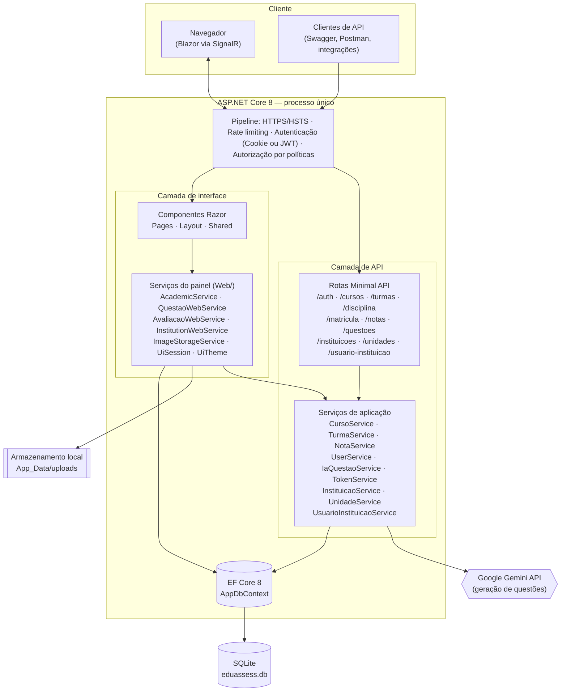
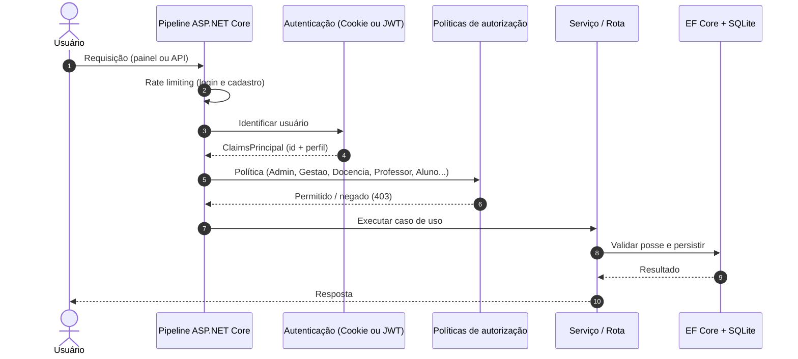
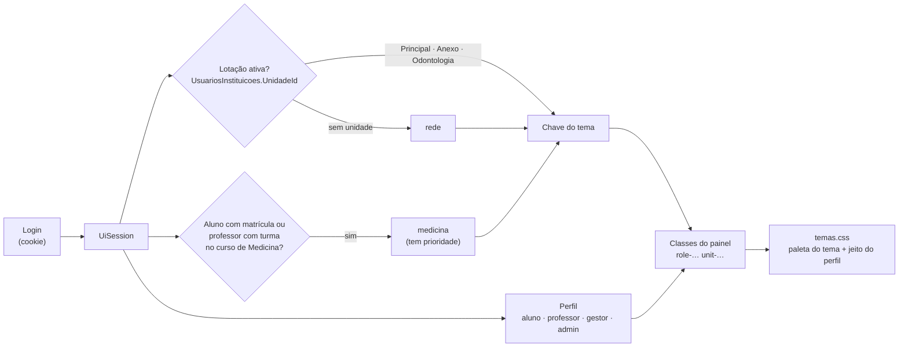
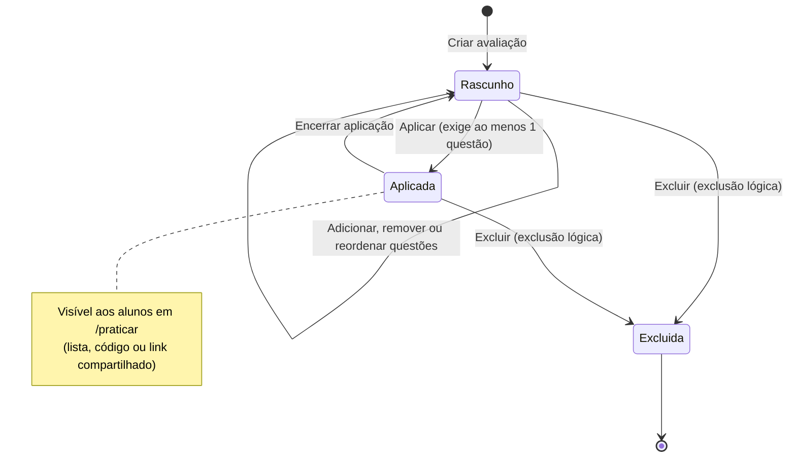
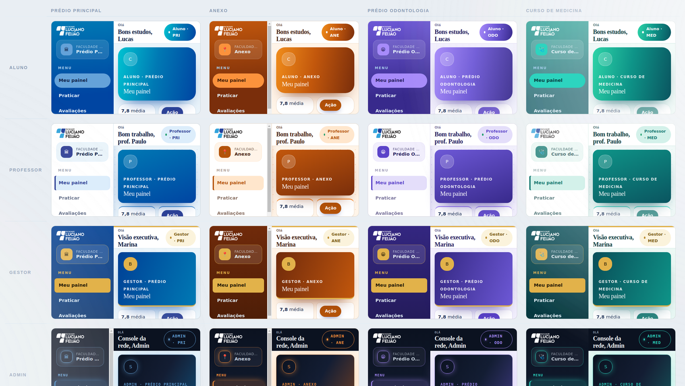
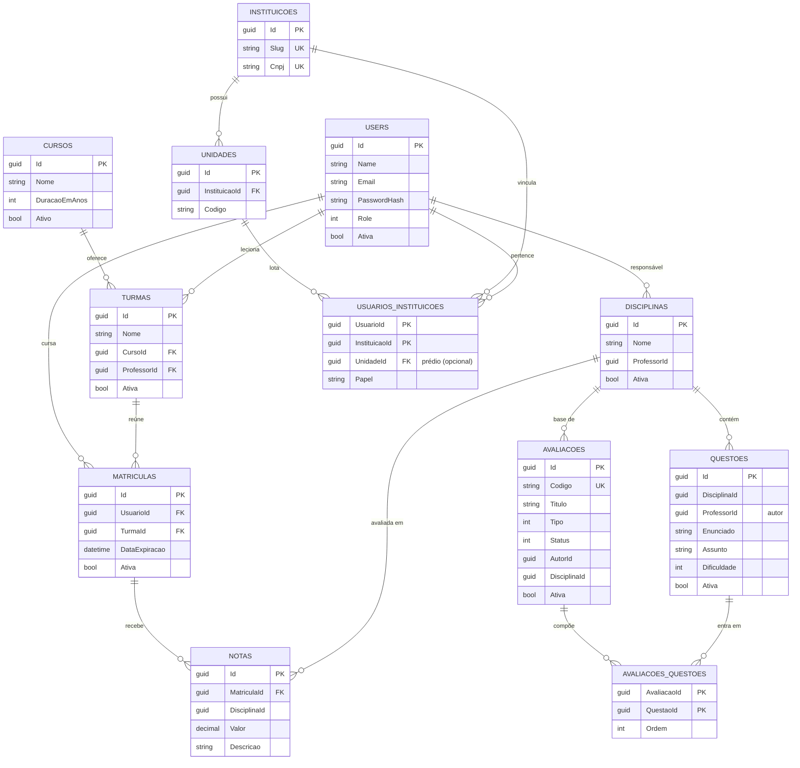
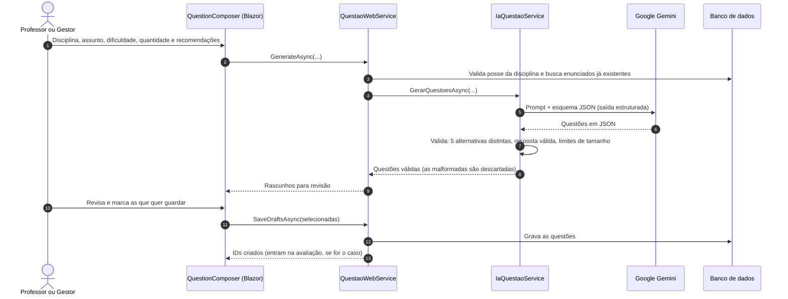

<div align="center">


# EduAssess

**Plataforma de gestão acadêmica e avaliações com IA para instituições de ensino superior.**

Cursos, turmas, matrículas, notas, banco de questões, provas e simulados — com geração de questões por IA, painel por perfil e API REST documentada.

[](https://dotnet.microsoft.com/)
[](https://learn.microsoft.com/dotnet/csharp/)
[](https://learn.microsoft.com/aspnet/core/blazor/)
[](https://learn.microsoft.com/ef/core/)
[](https://www.sqlite.org/)
[](https://ai.google.dev/)
[](#-api-rest)

<!--
Depois de publicar no GitHub, troque OWNER/REPO e descomente:
[](https://github.com/OWNER/REPO/actions/workflows/ci.yml)
[](https://github.com/OWNER/REPO/actions/workflows/codeql.yml)
-->

[Visão geral](#-visão-geral) •
[Arquitetura](#-arquitetura) •
[Começando](#-começando) •
[API](#-api-rest) •
[Segurança e LGPD](#-segurança-e-lgpd) •
[Roadmap](#-roadmap)

</div>

---

## 📑 Sumário

- [Visão geral](#-visão-geral)
- [Funcionalidades](#-funcionalidades)
- [Instituição, prédios e lotação](#-instituição-prédios-e-lotação)
- [Visual por perfil e por prédio](#-visual-por-perfil-e-por-prédio)
- [Arquitetura](#-arquitetura)
- [Stack tecnológica](#-stack-tecnológica)
- [Estrutura do repositório](#-estrutura-do-repositório)
- [Começando](#-começando)
- [Configuração](#-configuração)
- [Perfis e permissões](#-perfis-e-permissões)
- [Telas do sistema](#-telas-do-sistema)
- [API REST](#-api-rest)
- [Modelo de dados](#-modelo-de-dados)
- [Geração de questões com IA](#-geração-de-questões-com-ia)
- [Segurança e LGPD](#-segurança-e-lgpd)
- [Qualidade e testes](#-qualidade-e-testes)
- [Decisões de arquitetura](#-decisões-de-arquitetura)
- [Roadmap](#-roadmap)
- [Equipe e créditos](#-equipe-e-créditos)
- [Licença](#-licença)

---

## 🎯 Visão geral

O **EduAssess** reúne em um só lugar a rotina acadêmica de uma faculdade e o ciclo de avaliações:

| Quem | O que consegue fazer |
|---|---|
| **Gestão** (Admin e Gestor) | Cadastrar cursos, disciplinas, turmas, equipe e matrículas; acompanhar notas; montar avaliações. |
| **Professores** | Lançar notas nas **suas** turmas, criar questões (à mão ou pedindo à IA), montar provas e simulados e aplicá-los. |
| **Alunos** | Ver turmas, notas e médias; treinar com questões do banco; responder às avaliações aplicadas; gerenciar a foto do perfil. |

A plataforma é **multi-unidade**: a instituição é a **Faculdade Luciano Feijão** e a lotação das pessoas acontece em três prédios: **Prédio Principal**, **Anexo** e **Prédio Odontologia**. O **curso de Medicina** funciona como um *perfil* próprio: alunos e professores do curso ganham o visual de Medicina em qualquer prédio. Cada combinação de perfil (aluno, professor, gestor, admin) com prédio ou curso tem uma identidade visual exclusiva.

O projeto nasceu como base de gestão acadêmica e evoluiu para uma plataforma de **avaliação assistida por IA**, mantendo o professor sempre no controle: nada gerado pela IA vai para o banco sem revisão humana.

> **Estado atual:** funcional e em evolução. A seção [Segurança e LGPD](#-segurança-e-lgpd) descreve com honestidade o que já existe e o que ainda falta para uso em produção em larga escala.

---

## ✨ Funcionalidades

### Gestão acadêmica
- Cursos, disciplinas, turmas e equipe (gestores e professores) com ativação e desativação.
- Matrículas com data de expiração e vínculo aluno × turma.
- Notas por matrícula e disciplina, com média geral e por disciplina.
- Cadastro público de conta; a pessoa só ganha acesso de aluno quando alguém da docência atribui o perfil.
- Painel de gestão com indicadores e atalhos.

### Instituição, prédios e lotação
- Cadastro da instituição e das **unidades** (prédios), com sigla e tipo (campus ou polo); regras de nome, sigla e CNPJ únicos.
- **Lotação**: cada pessoa fica em um prédio; a tela `/instituicao` mostra quantas pessoas há por papel em cada unidade.
- Visual exclusivo por **perfil** e por **prédio/curso** (veja [Visual por perfil e por prédio](#-visual-por-perfil-e-por-prédio)), com login temático por prédio.
- O Admin pode **"ver como"** qualquer prédio ou o perfil de Medicina para conferir o tema.

### Avaliações (provas e simulados)
- **Cartões de avaliação** com código único (ex.: `GES-26-10-9GN`), autor, quantidade de questões, status e periodicidade.
- Filtros por autoria (*Minhas / Todas*), situação, busca e ordenação.
- Montagem: questões **do banco**, **geradas por IA** ou **escritas à mão**, com reordenação e remoção.
- **Aplicar / encerrar**: libera a avaliação para os alunos em `/praticar`.
- **Compartilhar**: copia o link `/praticar?codigo=…` para os alunos.
- Gabarito visível apenas para a equipe.

### Banco de questões e IA
- Questões de múltipla escolha (5 alternativas) com assunto, dificuldade e explicação.
- Geração por IA com **recomendações livres** (ex.: *estilo ENADE*, *casos práticos*) e proteção contra duplicatas.
- Prévia obrigatória: o professor revisa e escolhe o que salvar.

### Experiência do aluno
- Painel com média geral em anel animado, foco da semana e atalhos.
- **Minhas notas**: distribuição, evolução em gráfico interativo e médias por disciplina (não é um boletim formal).
- **Praticar**: treino livre por disciplina e avaliações aplicadas; feedback imediato, explicação, sequência de acertos e revisão dos erros.
- **Foto de perfil** recomprimida no servidor (versão leve + ícone nítido).

---

## 🏗 Arquitetura

O EduAssess é uma aplicação **monolítica modular** em ASP.NET Core 8: o mesmo processo hospeda o **painel Blazor Server** e a **API REST** (Minimal APIs). Ambos compartilham o mesmo banco, a mesma autenticação e as mesmas regras de posse.



### Fluxo de uma requisição autenticada

O esquema de autenticação é uma *policy scheme* que escolhe **JWT** (clientes de API, cabeçalho `Authorization: Bearer`) ou **Cookie** (painel Blazor) conforme a requisição. Depois disso, as políticas de autorização por perfil decidem o acesso, e os serviços aplicam a regra de **posse** (professor só altera o que é dele).



### Como o visual de cada pessoa é escolhido

Ao entrar, a sessão descobre **onde a pessoa está lotada** (prédio) e se ela é do **curso de Medicina**. O resultado vira duas classes CSS no elemento raiz do painel, e todo o estilo exclusivo está em `wwwroot/css/temas.css`.



### Ciclo de vida de uma avaliação



---

## 🧰 Stack tecnológica

| Camada | Tecnologia |
|---|---|
| Plataforma | .NET 8 · ASP.NET Core 8 · C# 12 (nullable habilitado) |
| Interface | Blazor Server (componentes Razor) · CSS próprio (design tokens, sem framework) |
| API | Minimal APIs com `MapGroup` · Swashbuckle (OpenAPI/Swagger) |
| Dados | Entity Framework Core 8 · SQLite · migrations versionadas |
| Autenticação | Cookie `HttpOnly` (painel) + JWT Bearer (API) · BCrypt.Net-Next |
| Validação | MiniValidation (DataAnnotations em DTOs) |
| Imagens | SixLabors.ImageSharp (recompressão para WebP) |
| IA | Google Gemini (REST, saída estruturada em JSON) |

---

## 📂 Estrutura do repositório

```text
EduAssess/
├── .github/
│   ├── workflows/                    # CI (build, auditoria) e CodeQL
│   └── dependabot.yml                # atualização automática de dependências
├── EduAssess.slnx
├── README.md
├── SECURITY.md                       # política de segurança e divulgação coordenada
├── CHANGELOG.md                      # histórico de mudanças (adicionado, alterado, corrigido)
├── docs/img/                         # imagens da documentação
└── EduAssess/                        # projeto web (Blazor + API)
    ├── Program.cs                    # composição: DI, autenticação, políticas, rate limit, rotas
    ├── Application/
    │   ├── DTOs/                     # contratos de entrada e saída da API
    │   ├── Interfaces/               # abstrações dos serviços
    │   ├── Routes/                   # endpoints Minimal API por recurso
    │   └── Services/                 # regras de negócio (inclui IaQuestaoService e TokenService)
    ├── Components/
    │   ├── Layout/                   # layouts (app, autenticação, público)
    │   ├── Pages/                    # telas (rotas @page)
    │   └── Shared/                   # componentes reutilizáveis (Modal, Icon, QuestionComposer...)
    ├── Extensions/                   # utilitários (ex.: GenerateSlug)
    ├── Data/                         # AppDbContext e DatabaseInitializer (migrations + seed)
    ├── Migrations/                   # histórico do esquema (EF Core)
    ├── Models/
    │   ├── Global/                   # base multi-instituição (Instituição, Unidade, vínculo)
    │   └── Local/                    # domínio acadêmico (User, Curso, Turma, Nota, Questão, Avaliação...)
    ├── Web/                          # serviços do painel (consultas, ações das telas, UiSession e UiTheme)
    ├── Converters/                   # conversores JSON
    ├── wwwroot/                      # CSS e imagens
    └── Test/EduAssess.http           # exemplos de chamadas da API
```

---

## 🚀 Começando

### Pré-requisitos

- [.NET SDK 8](https://dotnet.microsoft.com/download/dotnet/8.0)
- (Opcional) Chave de API do Gemini, apenas para gerar questões com IA — veja [Configuração](#-configuração)

### Executando

```powershell
git clone <url-do-repositorio>
cd EduAssess

dotnet restore .\EduAssess\EduAssess.csproj
dotnet run --project .\EduAssess\EduAssess.csproj --launch-profile "Front + API (HTTP)"
```

Abra <http://localhost:5062>. A raiz abre **direto na tela de login**.

Na **primeira execução em Desenvolvimento**, o sistema cria sozinho o banco (`EduAssess/eduassess.db`), aplica as migrations, cria um administrador e carrega dados de demonstração (cursos, disciplinas, turmas, questões e avaliações de exemplo).

#### Contas de demonstração

> ⚠️ Existem **somente em Desenvolvimento**. Nunca use estas credenciais fora do seu computador.

| Perfil | E-mail | Prédio | Visual |
|---|---|---|---|
| Administrador | `admin@eduassess.local` (senha `Admin@12345!`) | — (rede) | Console da rede |
| Gestor | `gestor@eduassess.demo` | Prédio Principal | Executivo · azul |
| Gestor | `gestor.anexo@eduassess.demo` | Anexo | Executivo · âmbar |
| Gestor | `gestor.odonto@eduassess.demo` | Prédio Odontologia | Executivo · violeta |
| Professor | `professor@eduassess.demo` | Prédio Principal | Ateliê · azul |
| Professor | `helena@eduassess.demo` | Prédio Odontologia | Ateliê · violeta |
| Professor | `professor.medicina@eduassess.demo` | Anexo (curso de **Medicina**) | Ateliê · verde-água |
| Aluno | `aluno@eduassess.demo` | Prédio Principal | Campus · azul |
| Aluno | `rafael@eduassess.demo` · `camila@eduassess.demo` · `aluno.anexo@eduassess.demo` | Principal · Anexo · Anexo | Campus (azul ou âmbar) |
| Aluno | `beatriz@eduassess.demo` | Prédio Odontologia | Campus · violeta |
| Aluno | `aluno.medicina@eduassess.demo` | Anexo (curso de **Medicina**) | Campus · verde-água |
| Conta sem perfil | `diego@eduassess.demo` | — | — |

Todas as contas `*.demo` usam a senha `Demo@12345`.

Para não criar os dados de demonstração: `"Seed": { "DemoData": false }` em `appsettings.Development.json`.

### Perfis de execução

| Perfil (`launchSettings.json`) | URL | Modo | Para quê |
|---|---|---|---|
| **Front + API (HTTP)** | `http://localhost:5062` | `Full` | Painel Blazor + API (abre em `/login`) |
| **Swagger (HTTPS)** | `https://localhost:7197/swagger` | `ApiOnly` | Somente a API documentada |

### Banco de dados

- **Banco novo:** o esquema é criado a partir do modelo atual e as migrations são marcadas como aplicadas.
- **Banco existente:** as migrations pendentes são aplicadas automaticamente ao iniciar.
- **Recomeçar do zero (apenas desenvolvimento):** apague `eduassess.db` (e os arquivos `-shm` / `-wal`).

```powershell
# Comandos úteis do EF Core
dotnet ef migrations add NomeDaMigration --project .\EduAssess
dotnet ef database update --project .\EduAssess
```

---

## ⚙️ Configuração

| Chave | Obrigatória | Descrição |
|---|---|---|
| `ConnectionStrings:DefaultConnection` | Sim | Cadeia do banco (padrão: `Data Source=eduassess.db`). |
| `JwtSettings:Secret` | **Sim, em produção** | Segredo do JWT com **mínimo de 32 bytes**. Em desenvolvimento é gerado em `App_Data/dev-jwt-secret.txt`. |
| `BootstrapAdmin:Email` / `BootstrapAdmin:Password` | Primeiro acesso em produção | Cria o primeiro administrador (senha com no mínimo 12 caracteres). |
| `Gemini:ApiKey` | Para usar a IA | Chave do Google AI Studio. **Nunca** coloque em `appsettings.json`. |
| `Gemini:Model` | Não | Modelo usado (padrão: `gemini-flash-lite-latest`). |
| `Seed:DemoData` | Não | `false` desativa os dados de demonstração (apenas Desenvolvimento). |
| `Seed:BaseInstitution` | Não | `false` impede a criação automática da instituição e dos três prédios (padrão: ligado, em qualquer ambiente). |
| `APP_MODE` | Não | `Full` (painel + API) ou `ApiOnly`. |

Segredos em desenvolvimento, com o gerenciador de segredos do .NET:

```powershell
cd EduAssess
dotnet user-secrets set "Gemini:ApiKey" "SUA_CHAVE_AQUI"
```

Em produção, use **variáveis de ambiente** (`JwtSettings__Secret`, `Gemini__ApiKey`) ou um cofre de segredos. Chaves de API gratuitas podem ser criadas em <https://aistudio.google.com/apikey>.

---

## 👥 Perfis e permissões

| Perfil | Descrição |
|---|---|
| `Admin` | Acesso total; cria gestores e administra a gestão. |
| `Gestor` | Cursos, disciplinas, turmas, matrículas, notas e avaliações; cria professores. |
| `Professor` | Lança notas só nas **suas turmas e disciplinas**; cria questões e avaliações; atribui perfil de aluno. |
| `Aluno` | Vê as próprias turmas, notas e médias; pratica questões e responde às avaliações aplicadas. |
| `User` | Cadastro público, sem privilégios até a atribuição do perfil de aluno. |

| Capacidade | Admin | Gestor | Professor | Aluno |
|---|:-:|:-:|:-:|:-:|
| Gerir cursos, turmas, disciplinas e matrículas | ✅ | ✅ | — | — |
| Criar gestores | ✅ | — | — | — |
| Criar professores | — | ✅ | — | — |
| Lançar notas | ✅ | ✅ | ✅ (as suas turmas) | — |
| Ver as próprias notas e médias | — | — | — | ✅ |
| Banco de questões e geração com IA | ✅ (todas) | ✅ (todas) | ✅ (as suas) | — |
| Criar, aplicar e excluir avaliações | ✅ (todas) | ✅ (todas) | ✅ (as suas) | — |
| Gerir instituição, unidades (prédios) e lotação | ✅ | ✅ | — | — |
| Ver o painel "como" outro prédio ou o perfil de Medicina | ✅ | — | — | — |
| Praticar e responder avaliações aplicadas | ✅ | ✅ | ✅ | ✅ |
| Atribuir perfil de aluno | ✅ | ✅ | ✅ | — |

As políticas de autorização definidas em `Program.cs` são: `Admin`, `Gestor`, `Gestao` (Admin ou Gestor), `Professor`, `Aluno`, `Docencia` (Admin, Gestor ou Professor) e `AtribuirAluno`.

---

## 🏫 Instituição, prédios e lotação

A camada **Global** do modelo guarda a instituição e a organização física dela:

| Conceito | Descrição |
|---|---|
| **Instituição** | Faculdade Luciano Feijão (nome, CNPJ, contatos). CNPJ e nome (slug) são únicos. |
| **Unidade** | Um prédio da instituição: **Prédio Principal**, **Anexo** e **Prédio Odontologia**. Tem sigla, tipo (campus ou polo) e ativação. Nome e sigla são únicos dentro da instituição. |
| **Lotação** | Vínculo de uma pessoa com a instituição e com **uma** unidade (`UsuariosInstituicoes.UnidadeId`, opcional). O papel institucional (Aluno, Professor, Gestor) acompanha o perfil do sistema. |
| **Curso de Medicina** | **Não é prédio.** É um perfil por curso: vale para o aluno com matrícula ativa e para o professor com turma ativa no curso de Medicina, em qualquer prédio. *Medicina Veterinária* não conta. |

Regras que o sistema aplica:

- Não dá para **desativar uma unidade** que ainda tem pessoas lotadas: mova-as antes.
- Pessoa sem unidade usa o visual da **rede** (instituição inteira).
- A instituição e os três prédios são criados automaticamente na primeira execução (`Seed:BaseInstitution`, ligado por padrão). **Confira o CNPJ e o endereço** em `/instituicao`: eles vieram do documento de autoria da faculdade.
- A tela `/instituicao` e as rotas `/instituicoes`, `/unidades` e `/usuario-instituicao` usam **as mesmas regras de negócio**.

---

## 🎨 Visual por perfil e por prédio

Cada pessoa vê um painel com identidade própria, resultado de **dois eixos**:



<sub>Pré-visualização gerada a partir do `temas.css` real (linhas: aluno, professor, gestor, admin; colunas: Prédio Principal, Anexo, Prédio Odontologia, Curso de Medicina).</sub>

**Eixo 1: tema (cores e emblema)**

| Tema | Quem recebe | Paleta | Emblema |
|---|---|---|---|
| **Principal** | Lotados no Prédio Principal (e a *rede* inteira) | Azul FLF (`#304296` · `#64a2d9`) | Prédio |
| **Anexo** | Lotados no Anexo | Âmbar e ferrugem (`#b45309` · `#fb923c`) | Pino de mapa |
| **Odontologia** | Lotados no Prédio Odontologia | Violeta (`#5b43c9` · `#a78bfa`) | Sorriso |
| **Medicina** | Alunos e professores do **curso** de Medicina | Verde-água (`#0f766e` · `#2dd4bf`) | Estetoscópio |
| *Nova unidade* | Qualquer unidade cadastrada depois | Cor automática derivada do nome | Camadas |

O tema de **Medicina tem prioridade** sobre o do prédio: um aluno de Medicina lotado no Anexo vê o visual de Medicina.

**Eixo 2: perfil (o "jeito" da interface)**

| Perfil | Identidade | Características |
|---|---|---|
| **Aluno** · *Campus* | Vivo e arredondado | Barra lateral em gradiente com brilho, cantos grandes, botão de perfil em gradiente. |
| **Professor** · *Ateliê* | Claro e funcional | Barra lateral clara com marcador lateral, fundo pontilhado, cartões com borda de destaque. |
| **Gestor** · *Executivo* | Sóbrio | Azul profundo, detalhes **dourados**, faixa dourada no topo, cantos discretos. |
| **Admin** · *Console* | Técnico | Grafite com grade, destaque neon na cor do tema, rótulos em fonte monoespaçada. |

Como usar e testar:

- **Login por prédio:** `/login?unidade=principal`, `anexo`, `odontologia` ou `medicina` abre o login com as cores daquele acesso. Depois de entrar, vale a lotação real da pessoa.
- **"Ver como" (Admin):** o seletor no topo troca o painel para qualquer prédio ou para o perfil de Medicina. A tela `/instituicao` também tem o botão *Ver tema*.
- **Onde mexer:** `wwwroot/css/temas.css` (paletas e perfis), `Web/UiTheme.cs` (catálogo e regras) e `Web/UiSession.cs` (descoberta de prédio e de curso).

---

## 🖥 Telas do sistema

| Rota | Quem acessa | Descrição |
|---|---|---|
| `/` · `/login` | Público | Login (a raiz abre direto aqui). |
| `/cadastro` | Público | Criação de conta. |
| `/painel` | Admin · Gestor | Visão geral da gestão com indicadores (os demais perfis são redirecionados ao próprio painel). |
| `/instituicao` | Admin · Gestor | **Instituição e unidades**: dados da faculdade, cartões dos prédios (com contagem por papel), perfil de Medicina e lotação das pessoas. |
| `/cursos` · `/disciplinas` · `/turmas` · `/matriculas` | Gestão | Cadastros acadêmicos. |
| `/equipe` · `/alunos` | Gestão · docência | Equipe e atribuição de perfil de aluno. |
| `/contatos` | Gestão | Solicitações de contato (legado do antigo site institucional). |
| `/notas` | Docência | Lançamento e consulta de notas. |
| `/avaliacoes` | Docência | Cartões de provas e simulados; janela de montagem de questões. |
| `/banco-questoes` | Docência | Criação de questões (IA ou manual), filtros e exclusão. |
| `/professor` | Professor | Painel do professor. |
| `/aluno` | Aluno | Painel do aluno. |
| `/aluno/notas` | Aluno | Médias e evolução das notas. |
| `/praticar` | Autenticado | Treino livre e avaliações aplicadas (lista, código ou link). |
| `/conta` | Autenticado | Dados pessoais, senha e foto de perfil. |

<!--
Capturas de tela (adicione os arquivos em docs/img/ e descomente):


-->

---

## 🔌 API REST

A API fica documentada no **Swagger** (perfil `Swagger (HTTPS)`) e tem exemplos prontos em [`EduAssess/Test/EduAssess.http`](EduAssess/Test/EduAssess.http). A autenticação usa **JWT Bearer**: obtenha o token em `POST /auth/login` e envie `Authorization: Bearer <token>`.

<details>
<summary><b>Autenticação e usuários</b> — <code>/auth</code></summary>

| Método | Rota | Acesso |
|---|---|---|
| `POST` | `/auth/register` | Público (limitado por *rate limit*) |
| `POST` | `/auth/login` | Público (limitado por *rate limit*) |
| `POST` | `/auth/users/managers` | Admin |
| `POST` | `/auth/users/professors` | Gestor |
| `GET` | `/auth/users/pending-students` | Admin · Gestor · Professor |
| `POST` | `/auth/users/{id}/assign-student` | Admin · Gestor · Professor |
| `GET` | `/auth/users` | Admin · Gestor |
| `GET` | `/auth/users/{id}` | Autenticado |
| `PUT` | `/auth/users/{id}/update` | Autenticado |
| `PUT` | `/auth/users/{id}/updateAdmin` | Admin |
| `PUT` | `/auth/users/{id}/UpdatePassword` | Autenticado |
| `DELETE` | `/auth/users/{id}` | Admin |

</details>

<details>
<summary><b>Cursos</b> — <code>/cursos</code></summary>

| Método | Rota | Acesso |
|---|---|---|
| `POST` | `/cursos/create` | Admin · Gestor |
| `GET` | `/cursos/list` | Admin · Gestor |
| `GET` | `/cursos/get/{nome}` | Admin · Gestor |
| `PUT` | `/cursos/update/{id}` | Admin · Gestor |
| `GET` | `/cursos/list/ativos` · `/cursos/list/inativos` · `/cursos/get/{id}` | Admin |
| `PUT` | `/cursos/ativar/{id}` | Admin |
| `DELETE` | `/cursos/delete/{id}` | Admin |

</details>

<details>
<summary><b>Turmas</b> — <code>/turmas</code></summary>

| Método | Rota | Acesso |
|---|---|---|
| `POST` | `/turmas/create` | Admin · Gestor |
| `GET` | `/turmas/list` | Admin · Gestor |
| `GET` | `/turmas/get/{id}` · `/turmas/list/professor/{professorId}` | Admin |
| `PUT` | `/turmas/update/{id}` · `/turmas/activate/{id}` | Admin |
| `DELETE` | `/turmas/delete/{id}` | Admin |

</details>

<details>
<summary><b>Disciplinas</b> — <code>/disciplina</code></summary>

| Método | Rota | Acesso |
|---|---|---|
| `POST` | `/disciplina/register` | Admin · Gestor |
| `GET` | `/disciplina/list` · `/list/ativas` · `/list/inativas` · `/list/professor/{professorId}` | Admin |
| `PUT` | `/disciplina/update/{id}` · `/disciplina/ativar/{id}` | Admin |
| `DELETE` | `/disciplina/delete/{id}` | Admin |

</details>

<details>
<summary><b>Matrículas</b> — <code>/matricula</code></summary>

| Método | Rota | Acesso |
|---|---|---|
| `POST` | `/matricula/register` | Admin |
| `GET` | `/matricula/matriculas` | Admin · Gestor |
| `DELETE` | `/matricula/end/{id}` | Admin · Gestor |
| `GET` `PUT` `DELETE` | `/matricula/matricula/{id}` | Admin |

</details>

<details>
<summary><b>Notas</b> — <code>/notas</code></summary>

| Método | Rota | Acesso |
|---|---|---|
| `POST` | `/notas/registrar` | Admin · Gestor · Professor |
| `GET` | `/notas/listar` | Admin · Gestor |
| `GET` | `/notas/minhas` | Autenticado (as próprias) |
| `GET` | `/notas/aluno/{idMatricula}` | Autenticado |
| `PUT` | `/notas/atualizar/{id}` | Professor |
| `DELETE` | `/notas/deletar/{id}` | Professor |

</details>

<details>
<summary><b>Instituição</b> — <code>/instituicoes</code></summary>

| Método | Rota | Acesso |
|---|---|---|
| `POST` | `/instituicoes/register` | Admin · Gestor |
| `GET` | `/instituicoes/list` · `/list/inativos` · `/{id}/usuarios` | Admin · Gestor |
| `GET` | `/instituicoes/list/ativos` · `/{id}` · `/{id}/unidades` | Autenticado |
| `PUT` | `/instituicoes/{id}` | Admin · Gestor |
| `PUT` | `/instituicoes/{id}/ativar` | Admin |
| `DELETE` | `/instituicoes/{id}` | Admin |

</details>

<details>
<summary><b>Unidades (prédios)</b> — <code>/unidades</code></summary>

| Método | Rota | Acesso |
|---|---|---|
| `POST` | `/unidades/register` | Admin · Gestor |
| `GET` | `/unidades/list` · `/list/inativos` | Admin · Gestor |
| `GET` | `/unidades/list/ativos` · `/{id}` · `/list/instituicao/{instituicaoId}` · `/list/tipo/{tipo}` | Autenticado |
| `PUT` | `/unidades/atualizar/{id}` · `/unidades/{id}/ativar` | Admin · Gestor |
| `DELETE` | `/unidades/{id}` (desativa; recusa se houver pessoas lotadas) | Admin · Gestor |

</details>

<details>
<summary><b>Lotação (vínculo pessoa × instituição × unidade)</b> — <code>/usuario-instituicao</code></summary>

| Método | Rota | Acesso | Descrição |
|---|---|---|---|
| `POST` | `/usuario-instituicao/vincular` | Admin · Gestor | Vincula (ou reativa) a pessoa, com `papel` e `unidadeId` opcional. |
| `PUT` | `/usuario-instituicao/atualizar` | Admin · Gestor | Muda papel e/ou unidade (prédio). |
| `DELETE` | `/usuario-instituicao/desvincular` | Admin · Gestor | Encerra o vínculo. |
| `GET` | `/usuario-instituicao/verificar-vinculo` · `/listar-instituicoes-por-usuario` · `/listar-usuarios-por-instituicao` | Admin · Gestor | Consultas. |

</details>

<details open>
<summary><b>Questões</b> — <code>/questoes</code></summary>

| Método | Rota | Acesso | Descrição |
|---|---|---|---|
| `POST` | `/questoes/create` | Docência | Cria uma questão manual. |
| `POST` | `/questoes/gerar-ia` | Docência | Gera questões com IA. Por padrão devolve só a **prévia**; com `?salvar=true` grava direto. |
| `GET` | `/questoes/get` | Docência | Lista com filtros `disciplinaId`, `assunto` e `dificuldade`. |
| `GET` | `/questoes/get{id}` | Docência | Busca uma questão (inclui a resposta correta). |
| `PUT` | `/questoes/update{id}` | Docência | Atualiza (professor: só as suas). |
| `DELETE` | `/questoes/delete{id}` | Docência | Exclusão lógica (professor: só as suas). |

Exemplo de pedido à IA:

```http
POST /questoes/gerar-ia?salvar=false
Authorization: Bearer <token>
Content-Type: application/json

{
  "disciplinaId": "00000000-0000-0000-0000-000000000000",
  "assunto": "Liderança situacional",
  "dificuldade": 1,
  "quantidade": 5,
  "recomendacoes": "Use casos práticos e evite pegadinhas."
}
```

`dificuldade`: `0` Fácil · `1` Média · `2` Difícil. A quantidade vai de 1 a 10 por chamada. Erros da IA retornam `429` (cota), `503` (IA não configurada) ou `502` (falha do provedor).

</details>

> As telas de **avaliações** usam serviços internos do painel (`AvaliacaoWebService`) e ainda não têm rotas REST públicas. Veja o [Roadmap](#-roadmap).

---

## 🗄 Modelo de dados



**Observações do modelo**

- Chaves primárias do tipo `Guid`; exclusão **lógica** (`Ativa`/`Ativo`) nas entidades acadêmicas.
- Relacionamentos com restrição de chave estrangeira no banco: matrícula → turma e usuário, turma → curso e professor, nota → matrícula, avaliação-questão → avaliação, unidade → instituição e vínculos de instituição. Os demais vínculos (por exemplo, questão → disciplina) são **lógicos**, validados pela aplicação.
- `Instituicoes`, `Unidades` e `UsuariosInstituicoes` formam a base para um futuro **modelo multi-instituição** (ainda não aplicado às demais tabelas).
- `Contatos` armazena solicitações de contato (legado do site institucional).

---

## 🤖 Geração de questões com IA

A IA **sugere**; a pessoa **decide**. O fluxo abaixo vale para a tela de banco de questões e para a janela de montagem de avaliações.



**Garantias do fluxo**

- **Sem dados pessoais na IA:** o prompt leva disciplina, assunto, dificuldade, quantidade, recomendações e enunciados já existentes (para evitar repetição). Nenhum dado de aluno é enviado.
- **Recomendações tratadas como dado:** o texto livre é limitado a 500 caracteres e a IA é instruída a ignorar pedidos que mudem o formato da resposta.
- **Resiliência:** uma nova tentativa automática em falhas temporárias (`500/502/503/504`) e erros mapeados para o cliente (`429`, `503`, `502`).
- **Validação defensiva:** alternativas vazias, repetidas ou longas demais e respostas fora das alternativas fazem a questão ser descartada.
- **Revisão humana obrigatória** antes de qualquer gravação no banco.

---

## 🔐 Segurança e LGPD

### Controles já implementados

| Área | Controle |
|---|---|
| **Senhas** | Hash com **BCrypt** (nunca em texto claro). |
| **Sessão** | Cookie `HttpOnly`, `SameSite=Lax`, expiração de 8 h com renovação deslizante; JWT com validação de tempo de vida. |
| **Autorização** | Políticas por perfil + regra de **posse** nos serviços (professor só altera o que é dele). Rotas de instituição e unidades exigem login; alterações exigem Gestão (e excluir/reativar instituição, só Admin). |
| **Abuso** | *Rate limiting* de 30 requisições por minuto em login e cadastro. |
| **Entrada de dados** | Validação por DataAnnotations (MiniValidation) nos DTOs da API e validações explícitas (tamanho, formato, posse) nos serviços do painel. |
| **Segredos** | Segredo JWT obrigatório em produção (mín. 32 bytes), chave da IA fora do repositório, `App_Data/` e `*.db` ignorados pelo Git. |
| **Uploads de imagem** | Limite de 8 MB, formato conferido pelo **conteúdo** (JPG, PNG, WebP, GIF), limite de pixels contra imagens "bomba", recompressão para WebP, remoção de metadados (EXIF/GPS) e **original descartado**. |
| **Arquivos** | Fotos servidas por rota autenticada, fora de pastas públicas. |
| **Transporte** | Redirecionamento HTTPS e HSTS. |
| **IA** | Nenhum dado de aluno enviado ao provedor; revisão humana antes de gravar. |

### Dados pessoais tratados

Nome, e-mail, CPF, telefone, data de nascimento, foto de perfil, matrículas e notas. A faculdade é a **controladora**; quem opera a plataforma atua como **operadora** (art. 39 da LGPD).

### Pendências conhecidas (antes de produção em larga escala)

| Prioridade | Item |
|---|---|
| 🔴 Alta | Trocar SQLite por banco gerenciado (PostgreSQL/SQL Server) com criptografia em repouso e backups testados. |
| 🔴 Alta | Criptografar **CPF e telefone** em nível de aplicação (hoje ficam em texto no banco) e mascará-los na tela. |
| 🔴 Alta | MFA para equipe e gestão; SSO institucional (OIDC/SAML). |
| 🔴 Alta | Trilha de **auditoria** (quem viu, alterou ou exportou dado pessoal) e logs sem dados pessoais. |
| 🟠 Média | Funcionalidades de direitos do titular: acesso, correção, exportação e exclusão/anonimização. |
| 🟠 Média | Política de retenção e descarte, RIPD (para IA, fotos e menores) e plano de resposta a incidentes. |
| 🟠 Média | Isolamento multi-instituição em todas as tabelas (filtros por instituição) e testes de vazamento. |
| 🟠 Média | Atualizar `SixLabors.ImageSharp` (avisos de vulnerabilidade no build) e automatizar a varredura de dependências (Dependabot). |
| 🟡 Normal | Pentest independente e cofre de segredos em produção. |

Para reportar uma vulnerabilidade, veja a [**Política de Segurança**](SECURITY.md).

> Este documento descreve o estado técnico do projeto e **não substitui** parecer jurídico. A adequação à LGPD é um programa que envolve contrato (DPA), encarregado, processos e treinamento, além do software.

---

## ✅ Qualidade e testes

| Item | Situação |
|---|---|
| Compilação | `dotnet build` (hoje com avisos NU1902/NU1903 do `SixLabors.ImageSharp`; atualizar o pacote). |
| Testes automatizados | **Ainda não existem.** Há apenas exemplos de chamadas em `EduAssess/Test/EduAssess.http`. |
| Integração contínua | **GitHub Actions** (`.github/workflows/ci.yml`): build em Release, testes (quando existirem), auditoria de dependências (falha em vulnerabilidade **alta ou crítica**) e higiene do repositório (bloqueia `*.db`, `App_Data/` e segredos em `appsettings`). |
| Análise de segurança | **CodeQL** (`codeql.yml`) a cada push, pull request e toda segunda-feira. |
| Dependências | **Dependabot** (`dependabot.yml`): PRs semanais para NuGet e GitHub Actions. |
| Análise estática | Analisadores padrão do SDK (`nullable` habilitado). |

Prioridades: testes de integração das rotas e das regras de posse, testes de componente (bUnit) para as telas críticas, pipeline de CI com build, testes e varredura de vulnerabilidades.

---

## 🧭 Decisões de arquitetura

| Decisão | Motivo | Consequência |
|---|---|---|
| **Monólito modular** (painel + API no mesmo processo) | Entrega rápida, uma única implantação, regras de negócio compartilhadas. | Escalar exige balanceamento com sessão fixa (Blazor Server). |
| **Blazor Server** | Tudo em C#, sem camada JavaScript própria, autenticação por cookie simples. | Uma conexão SignalR por usuário; avaliar Azure SignalR/Redis em escala. |
| **SQLite** | Zero configuração para desenvolvimento e demonstração. | Não é o destino de produção; trocar o provedor do EF Core. |
| **Exclusão lógica** | Preserva histórico acadêmico e referências. | Será necessária anonimização/descarte para atender a LGPD. |
| **IA com prévia obrigatória** | Qualidade e responsabilidade pedagógica ficam com o professor. | Mais um clique, porém sem questões sem revisão no banco. |
| **Fotos sem banco** | Arquivos nomeados pelo ID do usuário em `App_Data/uploads`, sem coluna nova. | Para vários servidores, migrar para armazenamento de objetos. |
| **Respostas de prática não gravadas** | Evita nova tabela e dados de desempenho antes da definição de retenção. | Não há histórico de tentativas nem relatórios de desempenho em provas. |

---

## 🗺 Roadmap

**Segurança e conformidade**
- [ ] PostgreSQL / SQL Server + criptografia em repouso
- [ ] Criptografia de CPF e telefone; mascaramento na interface
- [ ] MFA e SSO (OIDC/SAML)
- [ ] Trilha de auditoria imutável
- [ ] Direitos do titular (exportar, corrigir, excluir/anonimizar) e política de retenção
- [ ] Cofre de segredos (Key Vault / Secrets Manager)

**Produto**
- [x] Instituição, unidades (prédios), lotação e visual por perfil/prédio/curso
- [ ] Vincular **cursos** a unidades (hoje o perfil de Medicina é por nome do curso)
- [ ] Filtrar painéis e relatórios pela unidade da pessoa
- [ ] Gravar tentativas e resultados das provas; relatórios por turma e por questão
- [ ] Rotas REST para avaliações
- [ ] Importação de alunos (CSV) e integração com sistema acadêmico / LTI 1.3 (Moodle)
- [ ] Papéis granulares (coordenação por curso e unidade)
- [ ] Notificações por e-mail

**Engenharia**
- [x] CI com build, auditoria de dependências, CodeQL e Dependabot
- [ ] Testes automatizados (integração e componentes) e entrega contínua (CD)
- [ ] Multi-instituição completo (filtro global por instituição)
- [ ] Logs estruturados, métricas e *health checks*
- [ ] Paginação nas listagens e fila para geração de IA com limite por instituição
- [ ] Acessibilidade WCAG 2.1 AA

---

## 🤝 Equipe e créditos

Desenvolvido na **Faculdade Luciano Feijão** (período de desenvolvimento inicial: 03/10/2026 a 22/10/2026).

| Integrante |
|---|
| Ezequiel Barboza Madeira |
| Derik Andrey de Sousa Santos |
| Victor Wallace Liberato de Sousa |
| Joaquim Bismarck de Oliveira Bento |

### Convenções de contribuição

- Commits no padrão **Conventional Commits** (`feat:`, `fix:`, `docs:`, `refactor:`, `test:`).
- Alterações de esquema sempre acompanhadas de **migration** versionada.
- Mudanças de API acompanhadas de comentário explicando o que mudou e de exemplo em `EduAssess.http`.
- Nunca versionar segredos, `*.db` nem `App_Data/`.

---

## 📄 Licença

Licença **a definir**. A titularidade dos direitos patrimoniais do programa de computador será determinada conforme a legislação aplicável e os instrumentos jurídicos pertinentes. Enquanto isso, todos os direitos são reservados.

Este repositório não substitui o registro oficial do software perante o INPI.

<div align="center">

<sub>Feito com ☕ e .NET na Faculdade Luciano Feijão.</sub>

</div>
